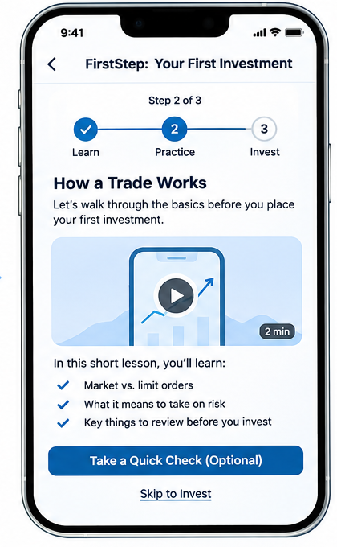

# Schwab FirstStep — Product Management Case Study

**Independent concept | Product discovery · Competitive analysis · Qualitative review coding · UX · PRD · Measurement**

**Prepared by Ruby Ryan | November 2026**

> **Independent case study disclaimer:** This is a personal educational portfolio project, **not affiliated with, sponsored by, reviewed by, or endorsed by Charles Schwab**. FirstStep is a hypothetical feature concept, not an existing Schwab product or an official interface. Product designs, requirements, and performance targets are proposals; no live product experiments or usability tests have been conducted.

## At a glance

| | |
|---|---|
| **Opportunity** | Explore whether optional, in-context education can help first-time adult investors understand financial terms and risks |
| **Target audience hypothesis** | First-time Gen Z investors; public reviews **do not verify reviewer age** |
| **Research** | Public-source comparison of Schwab, Fidelity, and Robinhood; **7 individually traceable App Store reviews** coded as an exploratory sample |
| **Concept** | Optional onboarding preferences, plain-language term explanations, guided learning, and non-punitive knowledge checks |
| **Status** | Independent discovery concept; unvalidated |

## The question

**How might Schwab build on its existing educational resources to support understanding and confidence at the moment first-time investors need guidance?**

Schwab already offers education and investing tools. This project investigates whether *placement and timing* of optional educational content might add value, rather than asserting the current product lacks education.

## Research approach and key findings

### 1. Public-source competitive research

A desk review compared Schwab, Fidelity, and Robinhood's publicly described experiences. It was used to formulate hypotheses—not to claim access to internal onboarding funnels or proprietary user data.

- **Schwab:** established investing and research capabilities; an opportunity to investigate contextual access to education, not a proven gap.
- **Fidelity:** broad investment and account capabilities; research question around clarity and account context.
- **Robinhood:** accessible in-app investing experience; research question around how to balance ease of use with transparent risk and transaction explanations.

[View competitive research workbook](01-Research/Investor_Onboarding_Research.xlsx)

### 2. Public customer review coding

**Seven identifiable public Apple App Store reviews** were reviewed and assigned one primary thematic code. This is a **small, purposively selected convenience sample**, not a representative survey.

| Platform | Reviews coded | Directional observations |
|---|---:|---|
| Schwab | 2 | Step-by-step guidance and functionality praised; visual-design criticism |
| Fidelity | 2 | Account-selection and performance-display clarity concerns |
| Robinhood | 3 | Beginner information praised; navigation and transaction-transparency concerns |

**What this means:** The evidence surfaces useful *questions* about clarity, navigation, and guidance. It **does not demonstrate** that Gen Z investors broadly struggle with Schwab onboarding, or prove that FirstStep would improve outcomes. One reviewer self-identified as a beginner, but no reviewer was verified as Gen Z.

[Open coded review workbook with source links and methodology](01-Research/Customer_Review_Coding.xlsx) · [Read the research analysis PDF](01-Research/Customer_Review_Analysis.pdf)

### Evidence → product hypotheses

| Directional signal | Hypothesis to validate | Proposed feature |
|---|---|---|
| Step-by-step guidance can be appreciated | Some new investors may value optional learning at decision points | Guided learning |
| Account context and performance information can confuse users | Plain-language explanations may reduce uncertainty | Contextual glossary |
| Beginner-friendly information can be appreciated | Users may prefer control over how much help appears | Optional learning preferences |
| Transaction wording and risk comprehension matter | Knowledge checks may reveal misunderstandings without pushing trades | Optional comprehension checks |

**These are design hypotheses, not validated causal links.**

## Proposed experience — three conceptual wireframes

### 01 · Welcome and preferences

Optional learning entry and topic selection, with a clear skip path.

### 02 · Learn in context

Plain-language explanations for investing terminology such as ETFs, without leaving the learning flow.

### 03 · Guided learning

Risk-aware educational steps and optional knowledge checks; no personalized securities recommendations or trades.

[See all wireframes](03-UX-Wireframes/)

## MVP requirements

| ID | Proposed feature | Design principle |
|---|---|---|
| US-01 | Contextual terminology explanations | Clear, accessible, non-promotional |
| US-02 | Guided first-investment education | Risk-aware, educational only |
| US-03 | Learning preferences | Optional and editable |
| US-04 | Knowledge checks | Non-punitive and skippable |

The MVP would require compliance, accessibility, privacy, and content review. Personalized investment advice, securities recommendations, and automated trades are out of scope.

[Read feature requirements](02-Product-Requirements/FirstStep_Feature_Requirements.md)

## How success would be evaluated

**Illustrative targets, not measured outcomes:**

| Metric | Hypothetical target |
|---|---|
| Pre/post knowledge assessment | +15 percentage points |
| Completion among voluntarily started modules | 60% |
| Positive self-reported confidence | +10 percentage points |

Guardrails include risk comprehension, onboarding friction, and confusion reports. A test would be considered only after interviews, prototype usability testing, and baseline measurement.

[Read the validation plan](05-Validation/Validation_Plan.md)

## Deliverables

| Artifact | Link |
|---|---|
| Executive presentation | [PDF](04-Executive-Presentation/Schwab_FirstStep_Executive_Presentation.pdf) · [PowerPoint](04-Executive-Presentation/Schwab_FirstStep_Executive_Presentation.pptx) |
| Competitive research | [Excel workbook](01-Research/Investor_Onboarding_Research.xlsx) |
| Coded customer reviews | [Excel workbook](01-Research/Customer_Review_Coding.xlsx) |
| Review findings and limitations | [Research PDF](01-Research/Customer_Review_Analysis.pdf) |
| Original case-study narrative | [PDF](02-Product-Requirements/Investor_Onboarding_Case_Study.pdf) |
| MVP requirements | [Markdown](02-Product-Requirements/FirstStep_Feature_Requirements.md) |
| Conceptual UX wireframes | [Images](03-UX-Wireframes/) |
| Validation plan | [Markdown](05-Validation/Validation_Plan.md) |

## What I would do next

1. Expand review sampling with a documented, reproducible inclusion strategy.
2. Interview actual first-time adult investors and establish whether the proposed pain points exist.
3. Audit Schwab's current education touchpoints to avoid duplication.
4. Test the three wireframes for comprehension, usability, and risk understanding.
5. Establish baseline metrics and work with relevant compliance stakeholders before any controlled experiment.

## Research integrity

Public app reviews are self-selected, may be old, may reflect advanced traders, and may contain unverified allegations. The seven-review dataset is **exploratory** and should not be generalized to all users or Gen Z. Review summaries are analyst paraphrases, not direct quotations. Some source dates are incomplete; these are identified in the workbook. The original case-study PDF represents an earlier concept stage; the coded-review analysis is the newer evidence addendum.

---

*All trademarks and brand names belong to their respective owners. This portfolio project is not financial advice.*
