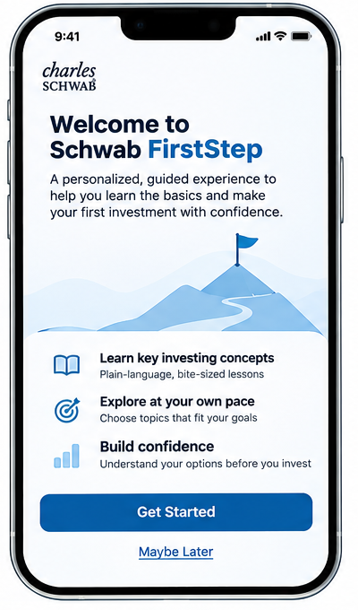
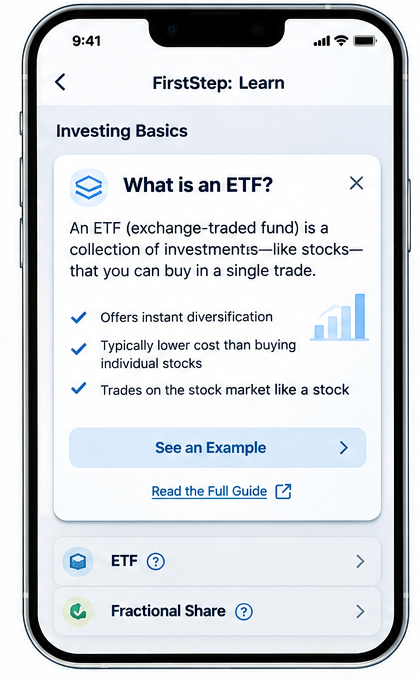

# Schwab FirstStep
### Independent Product Management Case Study

**Product Discovery | Competitive Research | Customer Insights | UX Design | Product Strategy**

**Created by:** Ruby Ryan  
**Date:** November 2026  
**Project Type:** Independent Product Management Portfolio Project  
**Status:** Concept Development & Exploratory Research

---

## Project Overview

**Schwab FirstStep** is a proposed educational feature designed to help first-time investors navigate investing concepts with greater clarity and confidence.

The concept explores how Charles Schwab could build upon its existing educational resources by introducing optional, contextual learning experiences directly within the investing journey.

Rather than replacing Schwab's existing tools, FirstStep investigates opportunities to make financial education more accessible at the moment users need it.

### Product Opportunity

**How might Charles Schwab improve the onboarding experience for first-time Gen Z investors to increase confidence, understanding, and readiness to make informed investment decisions?**

### My Role

Independent Product Researcher & Product Manager

**Responsibilities:**
- Product discovery and opportunity identification
- Competitive market research
- Qualitative customer review analysis
- Product requirements documentation
- Feature prioritization
- UX wireframing
- KPI development
- Product validation planning
- Executive presentation

---

## 1. Research & Discovery

The research phase incorporated two complementary approaches:

1. Public-source competitive analysis
2. Exploratory qualitative customer review analysis

The objective was to understand existing investing experiences, identify potential opportunities, and develop product hypotheses for further validation.

### Competitive Analysis

Three investment platforms were examined:

| Platform | Research Focus | Potential Opportunity |
|---|---|---|
| Charles Schwab | Existing education, investing tools, and beginner resources | Explore contextual access to educational content |
| Fidelity | Investment features, account management, and information presentation | Investigate account clarity and navigation |
| Robinhood | Accessible investing experiences and beginner-facing information | Explore transparency and risk-aware guidance |

**Key takeaway:** Existing platforms offer substantial investing capabilities and educational resources. The opportunity is to investigate whether integrating guidance into specific moments of the user journey could improve comprehension.

[View Competitive Research Workbook](01-Research/Investor_Onboarding_Research.xlsx)

---

## 2. Customer Review Analysis

An exploratory analysis was conducted using seven identifiable, publicly available Apple App Store reviews across Charles Schwab, Fidelity, and Robinhood.

Reviews were categorized by their primary themes, including:

- User experience and navigation
- Information clarity
- Beginner education
- Guided experiences
- Transaction transparency
- Visual design

### Initial Research Findings

| Platform | Reviews Analyzed | Directional Observations |
|---|---:|---|
| Charles Schwab | 2 | Positive feedback on functionality and step-by-step guidance; criticism of visual design |
| Fidelity | 2 | Concerns about account selection and performance-information clarity |
| Robinhood | 3 | Positive feedback on beginner-accessible information; concerns about navigation and transaction transparency |

### Research Interpretation

The initial findings suggest several areas worth investigating:

**1. Contextual guidance**  
Educational assistance may be particularly useful when users encounter unfamiliar concepts.

**2. Information clarity**  
Clear explanations and navigation may reduce uncertainty during investing-related tasks.

**3. User control**  
Optional learning experiences may help users access guidance without introducing unnecessary friction.

**4. Risk awareness**  
Educational experiences should support informed decisions without encouraging unnecessary trading.

These are exploratory hypotheses, not validated customer needs.

### Research Limitations

- The sample contains only seven reviews.
- Reviews were selected for exploratory analysis rather than statistical representation.
- Reviewer ages and Gen Z membership were not verified.
- Customer statements were not independently verified.
- No customer interviews or usability testing have been completed.
- Findings cannot establish the prevalence of issues across investment platforms.

[View Coded Customer Review Workbook](01-Research/Customer_Review_Coding.xlsx)

[Read Customer Review Analysis](01-Research/Customer_Review_Analysis.pdf)

---

## 3. Proposed Product Solution

### Introducing Schwab FirstStep

FirstStep is a conceptual, optional educational layer designed to complement Schwab's existing investing resources.

The proposed experience includes:

**Personalized Learning Preferences**
- Optional selection of beginner learning topics
- Ability to skip or modify preferences
- User-controlled educational experiences

**Contextual Financial Education**
- Plain-language explanations of investing terminology
- Educational information presented within relevant workflows
- Clear explanations of financial concepts and risks

**Guided Learning Experiences**
- Structured educational steps
- Beginner-friendly explanations
- Optional comprehension checks
- No personalized securities recommendations or automated trades

---

## 4. UX Wireframes

Three conceptual mobile wireframes were developed to illustrate the proposed experience.

### Wireframe 1: Welcome & Learning Preferences

**Purpose:** Introduce an optional educational experience and allow users to select learning preferences.

### Wireframe 2: Contextual Education

**Purpose:** Provide accessible explanations of investing terminology, such as ETFs, when users encounter unfamiliar concepts.

### Wireframe 3: Guided Learning

**Purpose:** Support financial understanding through guided educational content and optional knowledge checks.

**Design Principles:**
- Simplicity and clarity
- Accessibility
- User choice
- Financial risk awareness
- Educational guidance without trading pressure

*All wireframes are conceptual and do not represent official Charles Schwab interfaces.*

---

## 5. Product Requirements

A proposed Minimum Viable Product (MVP) was defined using four primary user stories.

| ID | Feature | Objective |
|---|---|---|
| US-01 | Contextual Glossary | Explain unfamiliar financial terminology |
| US-02 | Guided Learning | Support understanding of investment concepts and risks |
| US-03 | Learning Preferences | Allow users to customize optional educational content |
| US-04 | Knowledge Checks | Help users evaluate their understanding |

### Product Considerations

The proposed solution would require:

- Accessibility and inclusive design
- Privacy and data protection
- Financial content accuracy
- Compliance and legal review
- Clear risk disclosures
- Optional participation

**Out of Scope:**
- Personalized investment recommendations
- Automated trade execution
- Guaranteed investment outcomes
- Gamified incentives encouraging trading

[View Product Requirements](02-Product-Requirements/FirstStep_Feature_Requirements.md)

---

## 6. Success Metrics & KPIs

A preliminary measurement framework was developed to evaluate whether FirstStep could improve understanding and confidence.

| KPI | Illustrative Target |
|---|---|
| Knowledge Assessment Improvement | +15 percentage points |
| Voluntary Learning Module Completion | 60% |
| Positive Confidence Responses | +10 percentage points |

### Product Guardrails

Additional measures would evaluate:

- Risk comprehension
- Onboarding completion
- User confusion
- Educational content engagement
- Support-related questions

**Important:** These targets are hypothetical. They are not actual performance results and would require baseline measurement before use in a product experiment.

---

## 7. Validation Strategy

Before recommending development, I would validate the proposed solution through a structured research process.

**Phase 1 — Customer Discovery**
- Interview first-time adult investors.
- Identify recurring questions and challenges.
- Evaluate existing educational experiences.

**Phase 2 — Usability Testing**
- Test conceptual wireframes.
- Assess navigation and comprehension.
- Gather qualitative feedback.

**Phase 3 — Product Feasibility**
- Review existing Schwab capabilities.
- Evaluate accessibility and compliance requirements.
- Identify technical dependencies.

**Phase 4 — Controlled Experimentation**
- Establish baseline performance metrics.
- Test educational engagement and comprehension.
- Monitor guardrail metrics.
- Determine whether the solution warrants further investment.

[View Validation Plan](05-Validation/Validation_Plan.md)

---

## 8. Project Deliverables

| Deliverable | File |
|---|---|
| Executive Presentation | [View PDF](04-Executive-Presentation/Schwab_FirstStep_Executive_Presentation.pdf) |
| Editable Presentation | [View PowerPoint](04-Executive-Presentation/Schwab_FirstStep_Executive_Presentation.pptx) |
| Competitive Research | [View Excel](01-Research/Investor_Onboarding_Research.xlsx) |
| Customer Review Coding | [View Excel](01-Research/Customer_Review_Coding.xlsx) |
| Customer Review Analysis | [View PDF](01-Research/Customer_Review_Analysis.pdf) |
| Product Case Study | [View PDF](02-Product-Requirements/Investor_Onboarding_Case_Study.pdf) |
| Product Requirements | [View PRD](02-Product-Requirements/FirstStep_Feature_Requirements.md) |
| UX Wireframes | [View Designs](03-UX-Wireframes/) |
| Validation Plan | [View Plan](05-Validation/Validation_Plan.md) |

---

## 9. Key Takeaways

This project provided an opportunity to apply Product Management principles across the early product development lifecycle.

### Skills Demonstrated

- Translating market observations into product hypotheses
- Conducting competitive research
- Organizing qualitative customer feedback
- Identifying research limitations
- Developing product requirements and user stories
- Prioritizing MVP functionality
- Creating conceptual UX wireframes
- Defining success metrics and product guardrails
- Planning validation before product development
- Communicating product strategy to stakeholders

### Next Steps

Future work would include expanding the customer review sample, conducting interviews with first-time investors, testing the proposed wireframes, and evaluating whether contextual educational guidance provides measurable value beyond existing resources.

---

## Independent Case Study Disclaimer

**This project was independently developed by Ruby Ryan for educational and professional portfolio purposes.**

It is not affiliated with, sponsored by, reviewed by, or endorsed by Charles Schwab & Co., Inc. or The Charles Schwab Corporation.

Schwab FirstStep is a hypothetical product concept and does not represent an existing or officially proposed Charles Schwab feature.

All wireframes are conceptual. Research findings are exploratory, and proposed success metrics are hypothetical rather than measured results.

All company names and trademarks remain the property of their respective owners.

**This project does not provide financial or investment advice.**

---

**Ruby Ryan**  
Aspiring Product Manager | Information Technology Student  
Product Research • Technology Strategy • UX • Business Analysis
